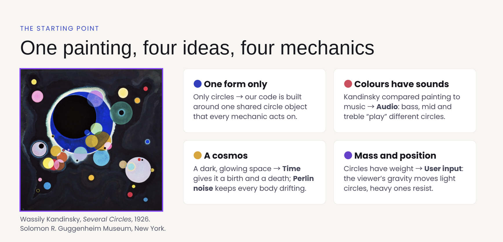
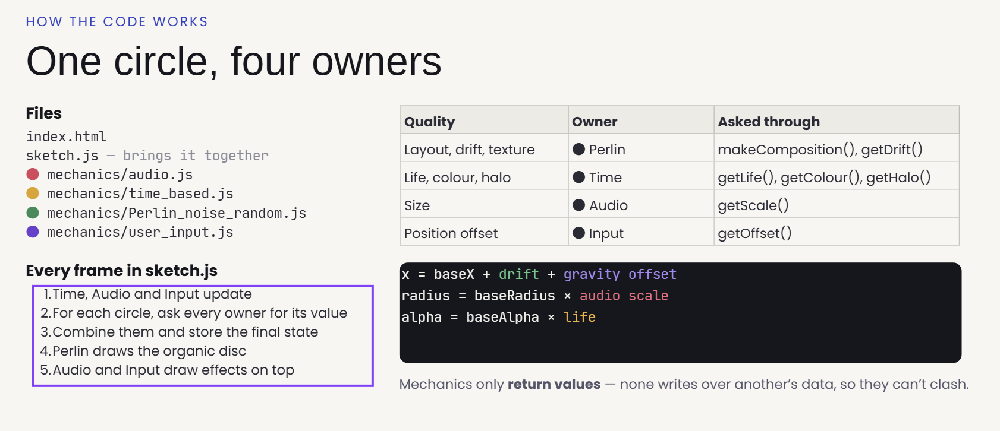
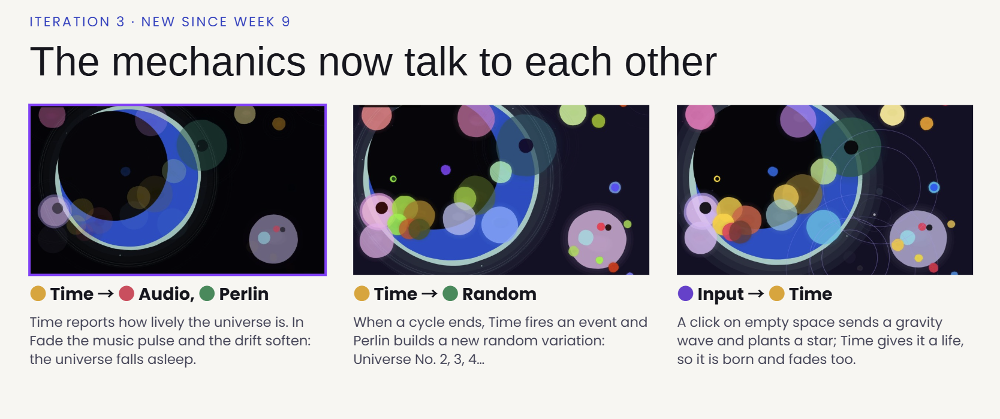
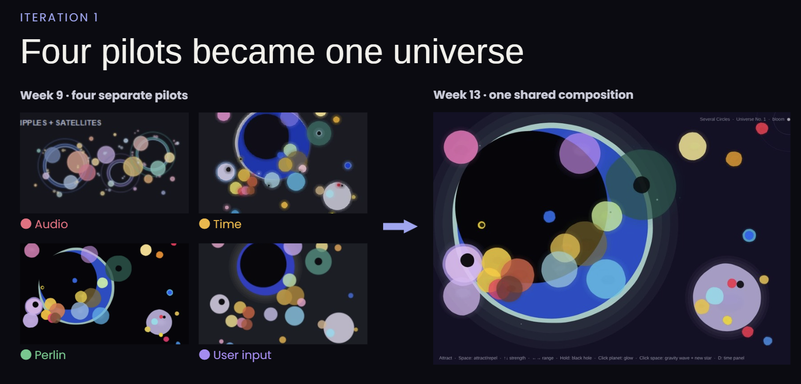
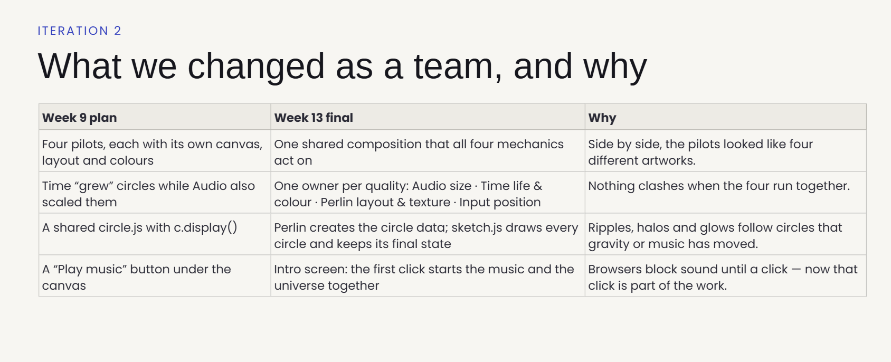
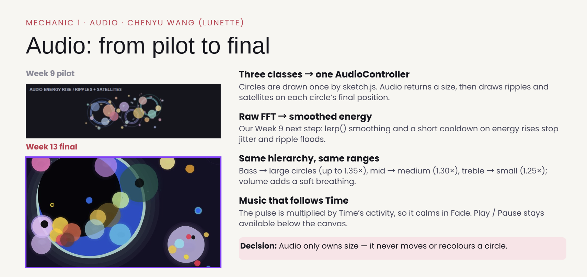
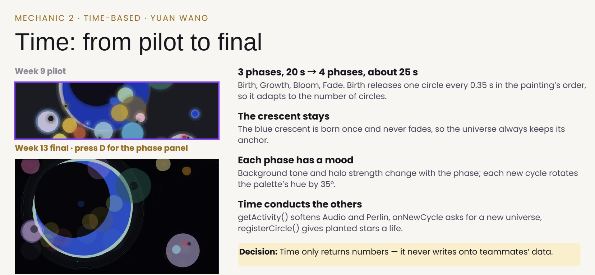
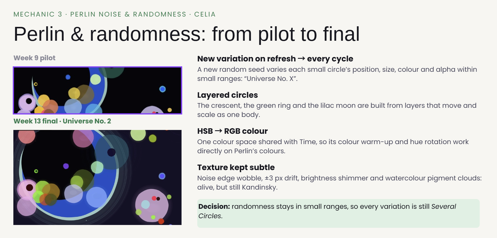
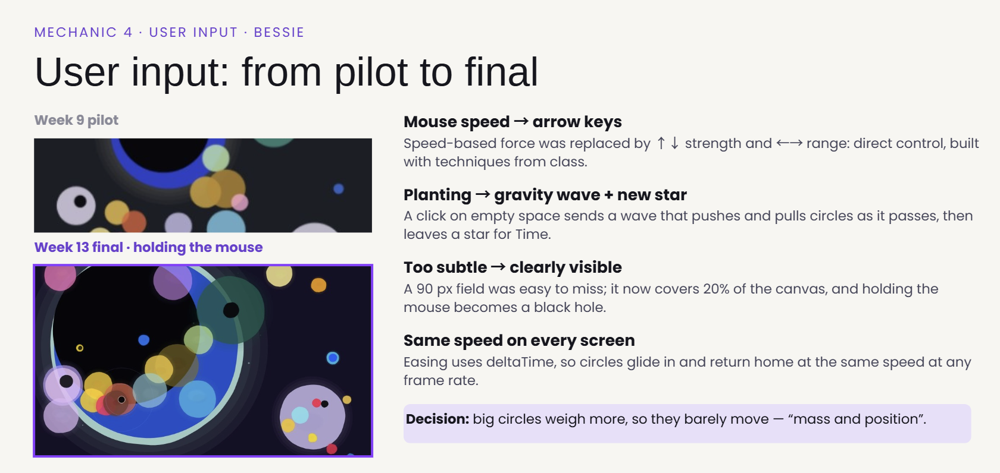

# A Universe of Circles

*A living, interactive reinterpretation of Wassily Kandinsky's **Several Circles** (1926), made with p5.js.*
IDEA9103 Creative Coding — Major Project, Group D

**▶ Live version:** https://celiaw33.github.io/yuwu6385_9103_GroupD/

| Member | Student ID | Mechanic | File |
|---|---|---|---|
| Chenyu Wang (Lunette) | cwan0059 | Audio | `mechanics/audio.js` |
| Yuan Wang | ywan0329 | Time-based | `mechanics/time_based.js` |
| Celia | yuwu6385 | Perlin noise & randomness | `mechanics/Perlin_noise_random.js` |
| Bessie | bshe0368 | User input | `mechanics/user_input.js` |

---

## 1. How to experience the work

1. Open the live version (or open `index.html` with a local server, e.g. VS Code Live Server).
2. **Click anywhere on the canvas to begin.** The first click starts the music and the universe's first life cycle. (Browsers do not allow sound until the viewer clicks.)
3. Watch: the circles are **born one by one**, warm into Kandinsky's colours, **bloom** and breathe with the music, then **fade** away. After every cycle a "big bang" ring bursts from the crescent and a new variation of the universe is born ("Universe No. 2, 3 …", top-right) with a shifted palette and a new smoky background.

| Action | What happens |
|---|---|
| **Move the mouse** slowly over the circles | The cursor is a gravity source: nearby circles are pulled towards it. Small circles fly, large circles barely move. |
| **Hold the mouse button** | "Black hole" — the pull becomes much stronger and the cursor turns into a dark core. |
| **Space** | Switch between **attract** (purple rings move inward) and **repel** (orange rings move outward). |
| **↑ / ↓** | Increase / decrease gravity strength. |
| **← / →** | Make the gravity field smaller / larger. |
| **Click a circle** | The planet glows. |
| **Click empty space** | A gravity wave ripples outward, pushing/pulling circles as it passes, and leaves a **new star** behind with a bright star-birth flash. The star is born and fades with the rest of the universe (max. 8 at a time). |
| **Push circles together** (hold the mouse over the warm cluster bottom-left, or send waves through the circles) | Circles squeezed into each other **mix their colours like light** and glow; a spark bursts where they first touch. Apart again, each slowly returns to its own colour. |
| **D** | Show / hide the Time panel (current phase and cycle number). |
| **Play / Pause music** button | Pause or resume the music. Audio effects calm down when the music is paused. |

---

## 2. Inspiration



**Wassily Kandinsky, *Several Circles (Einige Kreise)*, 1926** — Solomon R. Guggenheim Museum, New York ([guggenheim.org/artwork/1992](https://www.guggenheim.org/artwork/1992)).

Kandinsky painted this during his Bauhaus years, when he was studying how colour and form affect us emotionally. Four ideas from the painting and his writing shaped our project directly:

- **One form only.** The painting is built from nothing but circles — precise, transparent and overlapping. So our whole code is built around *one* shared kind of object: a circle with a position, size, colour and alpha. Every mechanic changes just one quality of these circles.
- **"Colours have sounds."** Kandinsky compared painting to music. This became the **Audio** mechanic: the music's bass, mid and treble each "play" a different group of circles.
- **A cosmos.** The dark background and glowing halos make the painting feel like outer space. We made that universe *live*: the **Time** mechanic gives it a birth, a bloom and a death, and **Perlin noise** gives every body a slow drift and a hand-painted, watercolour-like edge.
- **Mass and position.** Kandinsky described his circles through their weight and placement. The **User Input** mechanic makes this physical: the viewer becomes a gravity source, and heavy (large) circles resist while light (small) ones are pulled away.

We chose to **reinterpret rather than copy**: the composition stays recognisable (the large blue crescent, the green ring, the lilac "moon", the warm cluster bottom-left), but each viewing is a different moment in the life of this universe.

---

## 3. Techniques and how the code works

### Structure



```
index.html                       loads p5.js, p5.sound, the four mechanics, then sketch.js
sketch.js                        brings everything together (shared circles + per-frame pipeline)
mechanics/
  audio.js                       AudioController       — Lunette
  time_based.js                  Timer, TimeController — Yuan
  Perlin_noise_random.js         PerlinController      — Celia
  user_input.js                  InputController       — Bessie
assets/Galaxy.mp3                the music
```

Each mechanic is a **class** in its own file. `sketch.js` owns the shared `circles` array and, every frame, asks each mechanic for **one quality** of each circle. Mechanics only *return values*; they never overwrite each other's data, so they cannot clash:

| Quality of a circle | Owner | How sketch.js reads it |
|---|---|---|
| Starting layout, drift, edge texture, brightness shimmer | Perlin & Random | `makeComposition()`, `getDrift()`, `getLight()`, `drawOrganicDisc()` |
| Life (opacity), colour, halo, background, phase | Time | `getLife()`, `getColour()`, `getHalo()`, `getBackgroundColor()` |
| Size | Audio | `getScale()` |
| Gravity offset | User Input | `getOffset()` |

```
final x      = baseX + Perlin drift + Input offset
final radius = baseRadius × Audio scale
final alpha  = baseAlpha × Time life
```

The final values for every circle are stored in `renderStates` (id → x, y, radius, alpha, colour, halo). Effects that are drawn on top — Audio's ripples and satellites, Input's glows — read `renderStates`, so they follow a circle wherever gravity or music has moved it.

### Links between mechanics



- **Time → Audio & Perlin:** `getActivity()` is 1 in BLOOM and drops in FADE. Audio multiplies its pulse and Perlin its drift by this value, so the music's effect and the movement "fall asleep" with the universe.
- **Time → Random (event):** when FADE ends, Time fires its `onNewCycle` event. `sketch.js` asks Perlin for `newVariation()` — a new random seed and therefore a new version of the composition — which Time then gives birth to.
- **Input → Time:** clicking empty space returns `"wave"` from `handleMousePressed()`. `sketch.js` asks Perlin for a new star (coloured from the painting's own palette) and calls `timeController.registerCircle()`, so the viewer's star is born and dies like every other circle.
- **Input → colour:** after all positions are known, `inputController.updateCollisions()` finds circles that gravity has pushed deeper into each other than they sit in the painting. Their colours are mixed with a "screen" (light) blend, `255 − (255 − a)(255 − b) / 255` per channel, so red + blue becomes glowing pink and yellow + blue nearly white. `sketch.js` draws each circle with `getMixedColour()`. Pairs that already overlap in the painting stay calm.
- **Time → everyone (event):** when a new cycle begins, `drawCycleFlash()` sends a bright ring out of the crescent, so the change of universe is visible.

### Techniques used (and why)

| Technique | Where | Why |
|---|---|---|
| Classes and objects | every mechanic | Keeps each mechanic self-contained and makes ownership clear. |
| Arrays of objects, `for…of` loops | `circles`, ripples, glows | One loop draws every circle the same way. |
| `millis()` and a reusable `Timer` class | Time | Timing in milliseconds keeps the same rhythm on every computer (frame rates differ). |
| Phases + easing (`easeInOut`) | Time | Birth and fade start and end gently, which feels organic. |
| `lerpColor()` and a hue-rotation matrix | Time | Circles warm from cold grey-blue to their colour; each cycle rotates the palette. |
| `p5.FFT`, `p5.Amplitude` | Audio | Splits the music into bass / mid / treble, plus overall volume. |
| `lerp()` smoothing, energy-rise detection with cooldown | Audio | Removes jitter; turns beats into ripples without flooding the screen. |
| `noise()` (Perlin noise) | Perlin | Smooth, natural drift, light and edge wobble (`random()` would flicker). |
| `randomSeed()`, `noiseSeed()`, `random()` | Perlin | Each seed is a repeatable variation of the composition. |
| `beginShape()` / `vertex()` with noise around the edge | Perlin | Draws circles with a soft, hand-painted edge instead of a perfect geometric one. |
| `dist()`, normalised directions, mass weighting | Input | Gravity that is stronger close to the cursor and weaker on heavy circles. |
| Easing towards a target, `deltaTime` | Input, sketch | Circles glide and spring back home at the same speed on any screen. |
| `keyPressed()`, `keyCode`, `constrain()` | Input | Live control of mode, strength and range, kept within safe limits. |
| `push()` / `pop()` | everywhere | Each mechanic's styles stay inside its own drawing code. |
| `createGraphics()` + `noise()` + `random()` dabs | Perlin | Paints a smoky, uneven background once per universe (like the painting's ground), so it costs nothing per frame. |
| Pairwise overlap test + "screen" colour blending | Input | Circles pushed together mix colours like light — Kandinsky's overlapping transparent circles, made interactive. |

### Where our techniques come from

Checked against the IDEA9103 tutorials and lectures (Weeks 1–11):

| Technique | Taught in | Used in |
|---|---|---|
| Classes and constructors, arrays of objects | Weeks 7–8 | every mechanic |
| `keyPressed()`, `keyCode`, `constrain()` | Week 6 | user_input.js |
| `dist()` | Week 7 | user_input.js, audio.js |
| Timers with `millis()` | Week 5 | time_based.js |
| `noise()`, `random()` | Week 8 | Perlin_noise_random.js |
| `push()` / `pop()`, `translate()`, `rotate()` | Weeks 8 and 11 | all files |
| `colorMode()`, `windowResized()` | Week 8 | sketch.js |
| `loadSound()`, `p5.FFT`, `p5.Amplitude`, `createButton()` | Week 10 | audio.js |
| `beginShape()` / `vertex()` | Week 10 lecture | Perlin_noise_random.js |
| `lerp()` easing (easings.net) | Week 11 | every mechanic |

Outside the course (each one is explained and linked in a code comment): `createGraphics()`, `randomSeed()` / `noiseSeed()`, `lerpColor()`, `deltaTime`, `mouseIsPressed`, `userStartAudio()`, `async` / `await` / `try…catch`, `Object.assign()`, `Array.isArray()`, `includes()`, `shift()` / `splice()`, `red()` / `green()` / `blue()`, `pixelDensity()`, `.elt.blur()`.

### Key decisions





- **One owner per quality.** Early on our mechanics overlapped (Time and Audio both changed size). We agreed that Audio owns size, Time owns life and colour, Perlin owns layout and texture, and Input owns position offset. This made integration much easier.
- **Fixed design canvas, scaled by CSS.** We draw in a 960 × 680 design space and `style.css` scales the canvas to fit the window. This keeps Kandinsky's composition in proportion on every screen. p5 converts `mouseX`/`mouseY` to canvas coordinates, so the interaction still lines up after scaling.
- **The crescent stays.** The large blue crescent is drawn as one *layered* circle and does not fade with the phases, so the universe always has an anchor.
- **Intro screen.** Browsers block sound until the user clicks. Instead of a separate "play" step, the first click both starts the music and gives birth to the universe.
- **Colour that reacts to touch.** The painting's circles overlap like coloured glass. We kept the painting calm at rest, but when the viewer's gravity pushes circles deeper together, they mix like light and spark — the moment of interaction becomes visible in colour.
- **From "planting" to "gravity waves + stars".** In our Week 9 plan, clicking planted a new circle. During integration we added gravity waves, and in the final version the wave leaves a new star behind — so a click both disturbs the universe and adds to it.

---

## 4. Mechanic ownership

### Audio — Chenyu Wang (Lunette) · `mechanics/audio.js`


Music drives **size**. FFT splits the track into bass, mid and treble; large circles respond to bass, medium to mid and small to treble, while the overall volume adds a subtle breathing to everything. Sudden rises in a band release fading ripples, loud passages reveal small satellites orbiting the circles, and strong bass makes a glowing aura swell around the large circles. *Why:* it turns Kandinsky's belief that colours have sounds into something you can see.
*Decision:* in Week 9 the pilot had its own AudioCircle and AudioRipple classes; once the group shared one composition, these were merged into one AudioController that only returns a size and draws effects on top, so Audio never changes a circle's position or colour.

### Time-based — Yuan Wang · `mechanics/time_based.js`


Time drives **life, colour and phase**. A 4-phase cycle — Birth, Growth, Bloom, Fade — is controlled by `Timer` objects: circles are born one by one in the order of the composition, warm from grey-blue into colour, breathe with offset rhythms in Bloom, and fade one after another. Each phase has its own background tone, each new cycle rotates the palette and starts with a "big bang" ring from the crescent, and `getActivity()` tells Audio and Perlin how lively the universe is. *Why:* music has a beginning, a climax and an end — so does our universe.
*Decision:* the Week 9 plan had three phases in 20 seconds; a fourth phase, Growth, was added so each circle visibly warms from grey-blue into its colour, and the birth phase now scales with the number of circles (one every 0.35 s).

### Perlin noise & randomness — Celia · `mechanics/Perlin_noise_random.js`


Randomness drives **the composition**: each random seed slightly varies the position, size, colour and alpha of every small circle, so every cycle is a new "Universe No. X". Perlin noise drives **texture and motion**: gentle drift, a slowly wobbling edge, shifting brightness, watercolour-like pigment clouds, and a smoky painted background with a pale glow around the crescent (new for every universe). *Why:* the original is hand-painted and alive; noise brings back that imperfection.
*Decision:* colours were moved from HSB to RGB so Time can blend and hue-rotate the same values, and the crescent, green ring and moon became layered circles so each moves and scales as one body.

### User input — Bessie · `mechanics/user_input.js`


The viewer drives **position**. The mouse is a gravity source: circles within its field are pulled in or pushed away and glide back home when it leaves. Heavier (larger) circles move less, so Kandinsky's hierarchy stays readable. Holding the mouse creates a black hole; Space switches attract/repel; arrow keys change strength and range; clicking a planet makes it glow; clicking empty space sends a gravity wave that leaves a new star for the Time mechanic; circles pushed into each other mix their colours like light and spark. *Why:* it is the only mechanic that lets the viewer step inside the painting and *feel* the weight of each colour.

---

## 5. AI acknowledgement

We used AI tools as described below. Each AI-assisted part is also marked in the code with a comment (`AI-assisted` / `AI acknowledgement`).

**sketch.js (group)** — Claude (Anthropic) helped write the integration code: the per-frame pipeline that combines the four mechanics, the intro screen, planting stars, the `onNewCycle` link, drawing the painted background and the big-bang flash, the two-pass draw loop for collision colours, and the comments. *How it works:* see "Techniques and how the code works" above.

**audio.js (Lunette)**
- Human-written: `preload()` (loading the music), `getBand()` (choosing bass/mid/treble from circle size), `getScale()`, `update()`, `drawRipple()`.
- AI-assisted: `constructor()` (setting up audio and effect variables), `load()` (setting up FFT, amplitude and the music button), error handling in `togglePlayback()`, `drawSatellites()` (small dots orbiting with `Math.cos`/`Math.sin`).
- Claude (Anthropic) helped add `start()` for the intro screen, the `activity` link with Time, moving focus off the music button, the stronger ripples and bass aura, and comments on outside-course techniques.
- The AI-assisted parts are marked function by function in `audio.js` (`// AI-assisted`).

**time_based.js (Yuan)**
- Claude (Anthropic) helped add `getActivity()`, the `onNewCycle` event, `drawCycleFlash()` (the big-bang ring) and the header and technique comments in the final round.

**Perlin_noise_random.js (Celia)**
- AI-assisted: grouping the animation settings for testing, `getDrift()` and `getLight()` (mapping noise to drift and brightness), scaling the edge with the circle's size, `drawDisc()` (sampling noise around the edge with `beginShape()`/`vertex()`), `drawClouds()` (overlapping translucent pigment patches).
- Claude (Anthropic) helped add `newVariation()`, `makePlantedCircle()`, `getPalette()`, `makeBackground()` (the painted background), the `activity` link and the header comments.
- The earlier AI-assisted parts were developed with ChatGPT (OpenAI), as noted in the code history (`Developed with ChatGPT assistance`).

**user_input.js (Bessie)**
- The gravity, mass weighting, easing and keyboard controls come from Bessie's Week 9 pilot, written with help from Claude (Anthropic) and limited to techniques from class (plus easing).
- Claude (Anthropic) also helped clean up the file, add comments, the "black hole" hold feedback, the click result (`"glow"` / `"wave"`) that lets `sketch.js` plant a star, the star-birth flash, and the collision colour mixing with sparks (`updateCollisions()`, `drawSparks()`, `drawMixGlow()`).
- The gravity-wave ripples (`getRippleOffset()`, `drawClickRipples()`) were added during integration on 29 October (commit `9839c9b`).

---

## 6. External references

| Technique | Source | Used in |
|---|---|---|
| p5.js reference: `millis()`, `deltaTime`, `constrain()`, `lerp()`, `noise()`, `beginShape()`/`vertex()`/`endShape()`, `ellipse()` | https://p5js.org/reference/ | all files |
| `p5.FFT`, `p5.Amplitude`, `userStartAudio()` | https://p5js.org/reference/p5.sound/ | audio.js |
| `async` / `await`, `try…catch…finally` (waiting for the browser's permission to play sound) | https://developer.mozilla.org/en-US/docs/Learn_web_development/Extensions/Async_JS/Promises | audio.js |
| Nullish coalescing `??` | https://developer.mozilla.org/en-US/docs/Web/JavaScript/Reference/Operators/Nullish_coalescing | time_based.js |
| `Object.assign()` (copying an object) | https://developer.mozilla.org/en-US/docs/Web/JavaScript/Reference/Global_Objects/Object/assign | time_based.js |
| easeInOutQuad easing curve | https://easings.net/#easeInOutQuad | time_based.js |
| Hue-rotation matrix (feColorMatrix "hueRotate") | https://www.w3.org/TR/filter-effects-1/#feColorMatrixElement | time_based.js |
| `createGraphics()` (off-screen layer for the painted background) | https://p5js.org/reference/p5/createGraphics/ | Perlin_noise_random.js |
| `randomSeed()`, `noiseSeed()`, `lerpColor()`, `mouseIsPressed`, `pixelDensity()`, `red()` | https://p5js.org/reference/ | Perlin, Time, sketch |
| "Screen" blend mode formula (mixing colours like light) | https://www.w3.org/TR/compositing-1/#blendingscreen | user_input.js |
| Artwork | Kandinsky, W. (1926). *Several Circles* [Painting]. Solomon R. Guggenheim Museum. https://www.guggenheim.org/artwork/1992 | concept |
| Music: `assets/Galaxy.mp3` — *Galaxy Systems* by The_Mountain | The_Mountain. (2023, January 30). *Galaxy Systems by The_Mountain* \| Royalty-free music. Pixabay. https://pixabay.com/music/beats-galaxy-systems-136924/ (Pixabay Content License: https://pixabay.com/service/license-summary/) | audio.js |

---

## 7. Code comments

Every file starts with a header comment explaining what the mechanic does, what it owns and how it talks to the others. Functions are commented above their definition, variables are named descriptively (`fieldRadius`, `birthInterval`, `driftAmount`, `bandScale`), and every technique from outside the course is explained in a comment with a link to its source.

---

## 8. Commit notes

Some files were uploaded through GitHub's web page, which gave the commits the default message "Add files via upload". What each of those commits contains:

| Commit | Uploaded by | Work by | What it changed |
|---|---|---|---|
| `b20e79c` | Bessie | Bessie | Input: restored keyboard controls, cleaned up InputController, added comments |
| `fac90cd` | Bessie | Bessie | Input: larger gravity field and visible black hole when holding the mouse |
| `1d6dd90` | Bessie | Bessie | Input: gravity wave plants a new star that Time brings to life |
| `f60d2de` | Bessie | Yuan | Time: big-bang flash when a new universe begins |
| `3b1a07b` | Bessie | Bessie | Input: colliding circles mix colours and spark; star-birth flash |
| `6726af7` | Bessie | Celia | Perlin: painted, cloudy background generated with noise |
| `2ab5e7a` | Bessie | Celia | Sketch: painted background, big-bang flash and collision colour mixing |
| `a3c5d5a` | Bessie | Lunette | Audio: stronger beat ripples and a bass aura on large circles |

